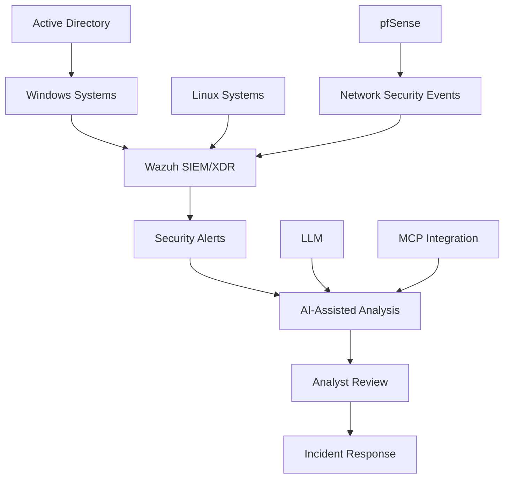
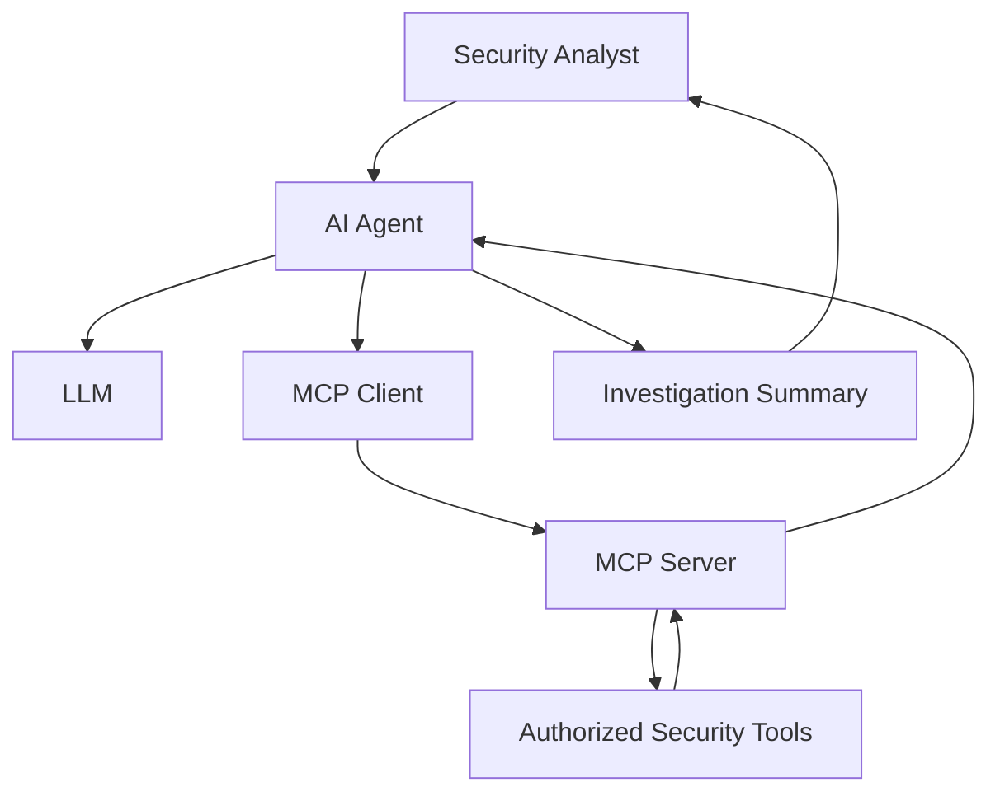

# AI-Driven SOC & Incident Response

## Project Overview

**Project Type:** Academic Cybersecurity Project  
**Period:** May 2026  
**Domain:** Security Operations, Incident Response & AI

### Objective

Explore the integration of Artificial
Intelligence into Security Operations
Center (SOC) workflows to support
security monitoring, threat analysis,
and incident response.

The project combined a simulated
enterprise infrastructure with SIEM/XDR
technologies and AI-based agents.

---

## 1. Technical Environment

The project environment included
Windows and Linux systems, Active
Directory, network security components,
and centralized security monitoring.

### Technology Stack

| Component | Technology |
|---|---|
| SIEM / XDR | Wazuh |
| Identity Management | Active Directory |
| Operating Systems | Windows, Linux |
| Network Security | pfSense |
| Messaging Infrastructure | Exchange |
| AI Integration | Large Language Models |
| Agent Connectivity | Model Context Protocol (MCP) |

### Conceptual Architecture

The following diagram represents
the main components and their
conceptual relationships.



This is a simplified conceptual
architecture, not an exact
representation of the deployed
network topology.

---

## 2. Security Monitoring with Wazuh

Wazuh was used as a central
security monitoring component.

### Main Areas of Investigation

- Security event collection
- Endpoint activity monitoring
- Alert generation and analysis
- Detection of suspicious behavior
- Security event correlation
- Incident investigation workflows

### Example Security Event

The following synthetic JSON
illustrates the type of
information a SOC analyst
might investigate:

```json
{
  "timestamp": "2026-05-15T10:30:00Z",
  "agent": {
    "name": "windows-workstation-01"
  },
  "rule": {
    "level": 10,
    "description": "Multiple authentication failures"
  },
  "data": {
    "srcip": "192.0.2.15",
    "user": "test-user"
  }
}
```

---

## 3. Enterprise Infrastructure

The simulated environment
included multiple components
commonly encountered in
enterprise networks.

### Active Directory

Active Directory provided
a context for investigating
identity-related security events.

Relevant monitoring scenarios
include:

- Failed authentication attempts
- Unusual account activity
- Changes to user permissions
- Privileged account activity

### Windows and Linux

The project included both
Windows and Linux systems.

This enabled the exploration
of security monitoring across
different operating systems.

### pfSense

pfSense was included as a
network security component.

Relevant security use cases
include:

- Firewall log analysis
- Suspicious connection monitoring
- Network traffic investigation
- Identification of unusual activity

### Exchange

Exchange was part of the
simulated enterprise environment.

Security monitoring
areas include authentication
events and suspicious
messaging-related activity.

---

## 4. AI Integration in SOC Workflows

A central focus of the project
was exploring how AI agents
could assist security analysts.

The approach involved
Large Language Models (LLMs)
and Model Context Protocol (MCP).

### AI-Assisted Tasks

- Summarizing security alerts
- Extracting relevant indicators
- Explaining suspicious activity
- Supporting incident triage
- Suggesting investigation steps
- Assisting with incident reporting

---

## 5. Model Context Protocol (MCP)

Model Context Protocol provides
a standardized approach for
connecting AI applications
to external tools and
data sources.


### Conceptual Workflow



The diagram illustrates
the integration concept.

---

## 6. Example Incident Investigation Workflow

The following scenario illustrates
how the different components
can support a SOC investigation.

### Scenario: Suspicious Authentication Activity

**Step 1 — Detection**

Wazuh identifies repeated
authentication failures
on a monitored system.

**Step 2 — Alert Collection**

The relevant security event
is collected and made
available for investigation.

**Step 3 — AI-Assisted Analysis**

An AI agent could summarize:

- The affected system
- The associated account
- The event timeline
- The source of activity
- Potential security implications

**Step 4 — Analyst Validation**

A security analyst reviews
the evidence and determines
whether the activity requires
further investigation.

**Step 5 — Incident Response**

Depending on the findings,
the analyst may recommend
appropriate containment,
remediation, or monitoring.


---

## 7. Security Considerations for AI Agents

Integrating AI into SOC
operations introduces
additional security requirements.

### Access Control

AI agents should operate
with clearly defined permissions.

### Human Oversight

Security-sensitive actions
should be reviewed and
authorized by analysts.

### Data Protection

Sensitive security telemetry
must be handled according
to applicable security
and confidentiality policies.

### Prompt Injection

Untrusted log content and
external data may contain
instructions intended to
manipulate AI behavior.

### Output Validation

AI-generated conclusions
must be validated against
the underlying security evidence.

---

## 8. Skills Demonstrated

### Security Operations

- SIEM/XDR fundamentals
- Security monitoring
- Alert investigation
- Incident response concepts

### Infrastructure Security

- Windows and Linux environments
- Active Directory
- Network security
- pfSense
- Exchange

### Artificial Intelligence

- LLM integration concepts
- AI-assisted security analysis
- Model Context Protocol
- Security automation
- Human-in-the-loop workflows

---

## 9. Key Takeaways

This project explored how
AI technologies can complement
traditional SOC capabilities.

The combination of SIEM/XDR,
enterprise infrastructure,
and AI agents provided a
practical context for studying
security monitoring and
AI-assisted incident response.

AI can support investigation
and analysis, but its outputs
must remain verifiable and
subject to appropriate
human oversight.

---

## Documentation Notice

This document presents
the project's technical
environment and conceptual
workflows.


