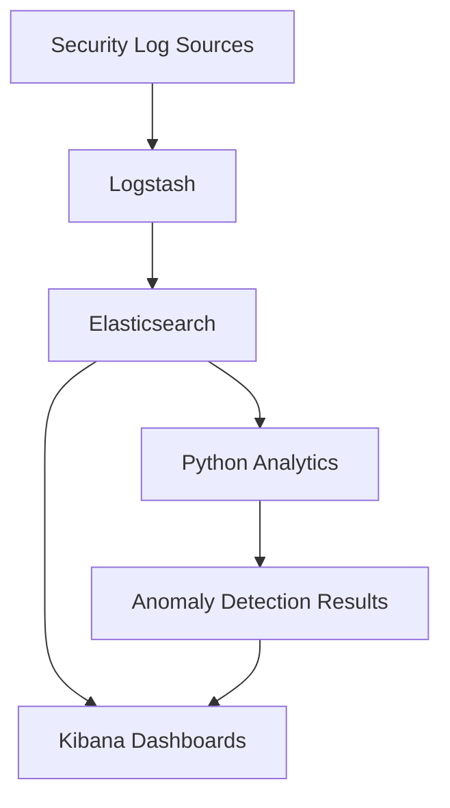

# Security Monitoring & Anomaly Detection

## Project Overview

**Organization:** Royal Air Maroc  
**Project Type:** Cybersecurity Internship  
**Period:** April – August 2025  
**Domain:** Security Operations & Threat Detection

### Objective

Develop and improve centralized security
monitoring capabilities using the Elastic
Stack and machine learning techniques.

The project focused on collecting and
analyzing security events, identifying
unusual user behavior, and providing
actionable visibility through dashboards.

---

## 1. Technical Environment

### Technologies

| Component | Technology |
|---|---|
| Log Management | Elasticsearch |
| Data Processing | Logstash |
| Visualization | Kibana |
| Data Analysis | Python |
| Anomaly Detection | Machine Learning |
| Security Analytics | User Behavior Analytics |

### Architecture Overview

The following diagram illustrates
a representative ELK-based monitoring
architecture.



This is a conceptual representation
of the solution.

---

## 2. Log Collection and Centralization

A major component of the project
involved centralizing security logs
for analysis.

The environment processed more
than 5,000 log events per day.

### Main Activities

- Collecting security-relevant events
- Processing incoming log data
- Structuring information for analysis
- Indexing events in Elasticsearch
- Making security telemetry searchable

### Example Logstash Pipeline

The following is an illustrative
configuration for processing JSON logs:

```text
input {
  file {
    path => "/var/log/security/*.json"
    start_position => "beginning"
    codec => "json"
  }
}

filter {
  if [user] {
    mutate {
      lowercase => ["user"]
    }
  }
}

output {
  elasticsearch {
    hosts => ["http://localhost:9200"]
    index => "security-events-%{+YYYY.MM.dd}"
  }
}
```

This example demonstrates the
principle of log ingestion and
normalization. 

---

## 3. Security Monitoring

Once centralized, security events
could be analyzed to identify
potentially suspicious activity.

### Investigation Areas

Examples of relevant monitoring
scenarios include:

- Repeated authentication failures
- Unusual login activity
- Unexpected access patterns
- Abnormal user behavior
- Significant deviations from
  established activity patterns

### Example Elasticsearch Query

A simplified query for failed
authentication events:

```json
{
  "query": {
    "term": {
      "event.outcome.keyword": "failure"
    }
  }
}
```

This illustrates how indexed
security events can be filtered
for investigation.

---

## 4. User Behavior Analytics

The project explored machine
learning techniques to identify
anomalies in user activity.

### General Methodology

1. Collect user activity logs.
2. Extract relevant behavioral features.
3. Prepare data for analysis.
4. Apply anomaly detection techniques.
5. Investigate unusual observations.
6. Visualize relevant findings.

### Example Behavioral Features

Potential features include:

- Number of login attempts
- Frequency of failed authentications
- Login time
- Number of accessed resources
- Activity volume over time

### Illustrative Python Example

The following example demonstrates
an unsupervised anomaly detection
approach using Isolation Forest.

It uses synthetic data and does
not reproduce the original
internship implementation.

```python
import pandas as pd
from sklearn.ensemble import IsolationForest

data = pd.DataFrame({
    "login_attempts": [3, 4, 2, 5, 3, 45],
    "failed_logins": [0, 1, 0, 0, 1, 35],
    "resources_accessed": [5, 6, 4, 7, 5, 80]
})

model = IsolationForest(
    contamination=0.15,
    random_state=42
)

data["prediction"] = model.fit_predict(data)

data["anomaly"] = data["prediction"] == -1

print(data)
```

Isolation Forest identifies
observations that differ from
typical patterns in the dataset.

A flagged observation is not
automatically a security incident;
additional investigation is required.

---

## 5. Kibana Dashboards

Kibana was used to visualize
security data and support analysis.

### Dashboard Objectives

- Monitor security event activity
- Identify unusual trends
- Explore event distributions
- Support investigation workflows
- Improve visibility into collected logs

### Example Visualizations

A security monitoring dashboard
could include:

| Visualization | Purpose |
|---|---|
| Events Over Time | Identify activity spikes |
| Failed Logins | Monitor authentication failures |
| Top Event Sources | Identify active log sources |
| User Activity | Analyze behavioral patterns |
| Anomaly Indicators | Highlight unusual observations |


---

## 6. Challenges and Considerations

### Data Quality

Security analysis depends on
the quality and consistency
of collected logs.

### False Positives

Unusual behavior is not always
malicious.

Detection results must be
interpreted within their
operational context.

### Scalability

Centralized monitoring systems
must support continuous ingestion,
indexing, and analysis.

### Confidentiality

Internal logs, infrastructure
details, and security dashboards
are not included in this
public-facing documentation.

---

## 7. Project Outcomes

The project provided practical
experience in:

- Centralized security log management
- ELK-based monitoring
- Processing more than 5,000 events daily
- Machine learning-based anomaly detection
- User Behavior Analytics
- Kibana dashboard development

---

## 8. Skills Demonstrated

**Security Operations**
- SIEM fundamentals
- Security monitoring
- Log analysis
- Threat detection

**Data Analytics**
- Data preparation
- Behavioral analysis
- Anomaly detection
- Data visualization

**Technologies**
- Elasticsearch
- Logstash
- Kibana
- Python
- Machine Learning

---

## Confidentiality Notice

This document describes the project
at a high level.

All sample configurations, queries,
and code are illustrative and use
non-confidential information.

No proprietary infrastructure
details, internal security logs,
or organizational data are disclosed.
