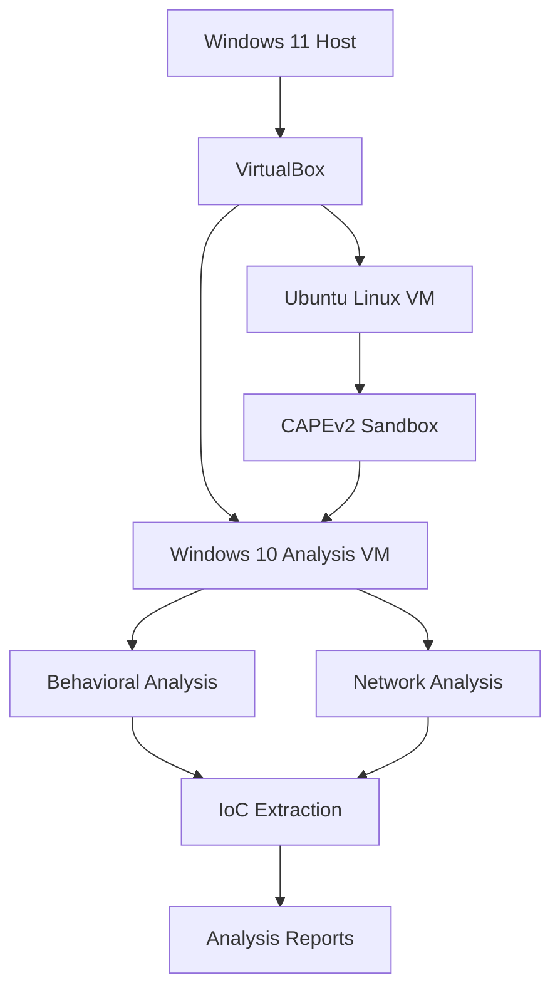
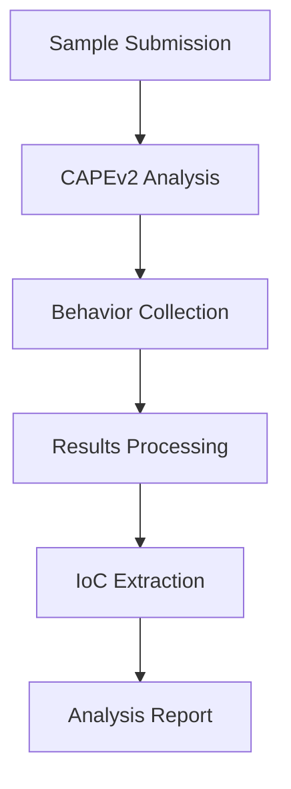

# Automated Cloud-Based Malware Analysis

## 1. Project Overview

**Project:** Final-Year Cybersecurity Project  
**Period:** December 2025 – May 2026  
**Environment:** Local VirtualBox Infrastructure  
**Sandbox:** CAPEv2

### Objective

Design and implement an automated
dynamic malware analysis pipeline
capable of executing suspicious
files in an isolated environment,
monitoring their behavior,
extracting Indicators of Compromise,
and generating investigation reports.

The project was initially designed
for cloud deployment on AWS.

Due to the unavailability of
educational AWS credits, the
solution was deployed locally
using Oracle VirtualBox.

The resulting sandbox was
functional and successfully
analyzed more than 10 malware samples.

---

## 2. Technical Architecture

### Infrastructure

| Component | Technology | Role |
|---|---|---|
| Host System | Windows 11 | Host environment |
| Virtualization | VirtualBox | Virtual machine management |
| Analysis Controller | Ubuntu Linux | CAPEv2 hosting |
| Guest System | Windows 10 | Isolated malware execution |
| Sandbox | CAPEv2 | Dynamic malware analysis |
| Automation | Python | Analysis pipeline and data processing |
| Network Analysis | Wireshark | Traffic inspection |

### Architecture Diagram

### Virtualization and Isolation

VirtualBox provided the
virtualized environment required
for dynamic malware analysis.

CAPEv2 operated from an Ubuntu
Linux virtual machine and
controlled a Windows 10 guest
environment used for executing
malware samples.

The environment used an isolated
virtual networking configuration.

Virtual machine snapshots
supported restoration of the
analysis environment between
executions.

---

## 3. CAPEv2 Sandbox Deployment

CAPEv2 was deployed and configured
as the core dynamic analysis
platform.

The sandbox enabled the execution
of suspicious files within the
Windows guest environment while
collecting behavioral information.

### Implemented Capabilities

- Malware sample submission
- Execution in a virtualized environment
- System behavior monitoring
- Network activity collection
- Analysis results processing
- Report generation

The CAPEv2 web interface was
used to submit samples and
inspect analysis results.

Python scripts supported
automation of the analysis
and results-processing workflow.

---

## 4. Automated Analysis Pipeline

The project implemented an
automated workflow covering
the main stages of malware
analysis.

### Pipeline Architecture

### Workflow

**1. Sample Submission**

Suspicious files were submitted
to the CAPEv2 analysis environment.

**2. Dynamic Analysis**

Samples were executed in
the isolated Windows 10
guest environment.

**3. Behavioral Monitoring**

The sandbox collected information
about system and network activity.

**4. Automated Processing**

Python scripts processed
analysis results and extracted
relevant security information.

**5. IoC Extraction**

Indicators associated with
the analyzed samples were
identified and collected.

**6. Reporting**

Analysis reports summarized
the observed behaviors and
relevant indicators.

---

## 5. Behavioral Malware Analysis

The sandbox collected behavioral
information to investigate
the activity of suspicious files.

### Process Activity

Analysis included monitoring
process execution and related
activity.

### File System Activity

File operations were examined
to identify changes performed
during sample execution.

### Windows Registry

Registry activity was analyzed
to identify modifications
associated with the executed
samples.

### Persistence Mechanisms

Analysis included investigating
behaviors associated with
malware persistence.

### Behavioral Correlation

System activity was correlated
with network observations
to improve understanding
of sample behavior.

---

## 6. Network Traffic Analysis

Wireshark was used to investigate
network communications associated
with malware execution.

### Investigated Activity

- DNS queries
- HTTP communications
- Network connections
- Suspicious remote destinations
- Potential command-and-control
  communication patterns

### Investigation Objectives

Network analysis helped identify
external destinations contacted
by analyzed samples.

The findings were correlated
with system-level observations
to characterize suspicious
behavior.

---

## 7. Indicators of Compromise

The project extracted Indicators
of Compromise from malware
analysis results.

### Extracted Indicators

| IoC Type | Description |
|---|---|
| File Hashes | File identification |
| IP Addresses | Network destinations |
| Domains | Contacted domain names |
| DNS Queries | Domain resolution activity |
| Network Connections | Communication activity |

### IoC Processing

Python scripts were used to
process collected analysis data
and extract relevant indicators.

These indicators supported
the investigation and reporting
of observed malware behavior.

---

## 8. Testing and Validation

The sandbox was tested through
the submission and execution
of malware samples.

### Validation Activities

- Submitted samples to CAPEv2.
- Verified execution in the
  Windows 10 guest environment.
- Examined collected system events.
- Investigated network activity.
- Verified the availability
  of analysis results.
- Reviewed generated reports.
- Extracted relevant IoCs.

### Results

**More than 10 malware samples
were successfully analyzed.**

The project demonstrated:

- Functional sandbox deployment
- Successful dynamic execution
- System behavior collection
- Network activity investigation
- Automated results processing
- IoC extraction
- Analysis report generation

---

## 9. Technical Challenges

### Cloud Deployment Constraints

The initial project architecture
targeted AWS infrastructure.

However, the required educational
cloud credits were not available.

### Local Deployment

The implementation was therefore
adapted to a local VirtualBox
environment.

This enabled the project to
retain its core analysis
objectives without depending
on cloud resources.

### Outcome

The local deployment successfully
supported the dynamic malware
analysis pipeline.

---

## 10. Skills Demonstrated

### Malware Analysis

- Dynamic analysis
- Behavioral investigation
- Malware sandboxing
- Indicators of Compromise

### Infrastructure

- VirtualBox
- Ubuntu Linux
- Windows 10
- Virtual machine management

### Security Analysis

- Network traffic analysis
- HTTP and DNS investigation
- System and network correlation
- Security reporting

### Automation

- Python scripting
- Automated results processing
- Analysis pipeline implementation

---

## 11. Conclusion

This project provided hands-on
experience in deploying and
operating a functional malware
analysis sandbox.

The implementation combined
virtualization, dynamic analysis,
network investigation, and
Python automation to analyze
more than 10 malware samples.

Adapting the architecture from
the initially planned AWS
deployment to a local VirtualBox
environment also demonstrated
the ability to deliver a
functional cybersecurity solution
under infrastructure constraints.
