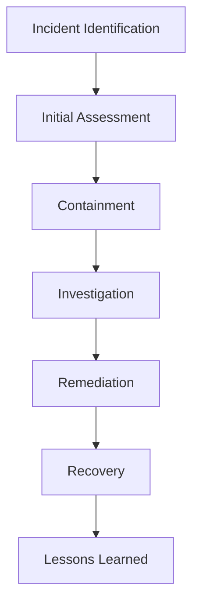

# AI Governance & Security Awareness

## Enterprise Generative AI Security Governance

**Organization:** E2IP Technologies  
**Project Type:** Cybersecurity Engineering Internship  
**Focus:** AI Governance | Risk Management | Security Policies | Security Awareness

---

## 1. Project Overview

This project focused on developing an AI security governance framework to support the secure and responsible adoption of Generative AI (GenAI) and Large Language Models (LLMs) in an enterprise environment.

The work complemented the technical AI security assessment and the evaluation of enterprise AI security solutions.

While technical controls help detect and prevent security threats, organizational governance establishes the policies, responsibilities, and procedures required to manage AI-related risks.

The project addressed both technical and organizational dimensions of AI security.

### Main Objectives

- Establish guidelines for secure enterprise AI usage.
- Define data protection requirements for GenAI applications.
- Structure the management of AI-related security incidents.
- Clarify AI security roles and responsibilities.
- Promote employee awareness of AI security risks.
- Develop a roadmap for strengthening AI governance.

---

## 2. Governance Framework

The governance work was informed by recognized cybersecurity and AI risk management frameworks.

### Reference Frameworks

**NIST AI Risk Management Framework (AI RMF)**

Provided a structured approach to identifying, assessing, and managing AI-related risks.

**NIST AI RMF Generative AI Profile**

Supported the consideration of risks specific to Generative AI systems.

**OWASP Top 10 for LLM Applications**

Provided a technical reference for understanding security vulnerabilities and threats affecting LLM-based applications.

### Governance Approach

The work connected AI risk assessment findings with organizational security requirements.

It addressed:

- AI usage policies
- Information protection
- Security responsibilities
- Incident response
- Employee awareness
- Governance monitoring and improvement

---

## 3. AI Acceptable Use Policy

### Objective

Define rules and responsibilities governing the use of Generative AI tools within an enterprise environment.

The policy aimed to reduce security risks associated with inappropriate or unauthorized AI usage.

### Policy Areas

**Authorized AI Usage**

Define acceptable professional uses of AI tools in accordance with organizational requirements.

**Restricted AI Usage**

Identify activities requiring additional authorization, validation, or security controls.

**Prohibited AI Usage**

Establish restrictions on activities that could expose sensitive information or create unacceptable security risks.

**Employee Responsibilities**

Clarify employee obligations when interacting with external AI applications.

**Security Requirements**

Establish expectations regarding confidentiality, data handling, and compliance with internal security policies.

### Governance Value

An AI Acceptable Use Policy provides a foundation for consistent and accountable AI adoption across an organization.

---

## 4. AI Data Protection Guidelines

### Objective

Define security recommendations to protect sensitive information when employees interact with Generative AI applications.

### Key Areas

#### Data Classification

Consider the sensitivity of information before submitting it to AI services.

#### Confidentiality

Establish guidelines for protecting internal business information and confidential documents.

#### Personal Data Protection

Address privacy and data protection concerns associated with the processing of personal information.

#### Credentials and Secrets

Define restrictions concerning the disclosure of passwords, API keys, authentication tokens, and other sensitive credentials.

#### External AI Services

Consider the security implications of transferring organizational information to third-party AI platforms.

### Recommended Security Measures

- Data Loss Prevention controls
- Sensitive information detection
- AI usage monitoring
- Access management
- Security policy enforcement
- Employee awareness

These guidelines complemented the technical evaluation of AI security solutions.

---

## 5. AI Security Incident Response Procedure

### Objective

Develop a structured procedure for managing security incidents associated with AI usage.

The procedure addressed the need to identify, investigate, respond to, and document AI-related security events.

### Incident Response Lifecycle

### Incident Categories

The procedure considered security concerns such as:

- Sensitive information exposure
- Unauthorized AI usage
- Credential disclosure
- AI-related security policy violations
- Suspicious interactions with AI applications

### Procedure Components

**Identification**

Recognize and report potentially harmful AI-related security events.

**Assessment**

Evaluate the nature, scope, and potential impact of the incident.

**Containment**

Identify appropriate actions to limit further exposure.

**Investigation**

Review available evidence and determine the circumstances of the incident.

**Remediation and Recovery**

Define corrective actions and restore secure operations.

**Lessons Learned**

Document findings and identify opportunities to improve security controls and governance processes.

---

## 6. AI Governance RACI Matrix

### Objective

Clarify organizational roles and responsibilities related to AI security governance.

A RACI matrix was developed to structure accountability across relevant stakeholders.

### RACI Principles

| Designation | Meaning |
|---|---|
| Responsible | Performs the activity |
| Accountable | Owns the final decision and outcome |
| Consulted | Provides expertise or input |
| Informed | Receives relevant information |

### Stakeholder Categories

The governance approach considered stakeholders such as:

- Executive Management
- Information Security
- IT Operations
- Business Teams
- Legal and Compliance Functions

### Governance Activities

Responsibilities were structured around activities including:

- AI security policy management
- AI risk assessment
- Data protection
- Security incident handling
- Employee awareness
- Governance monitoring

The RACI approach helped clarify ownership and coordination across organizational functions.

---

## 7. AI Security Awareness

### Objective

Develop security awareness recommendations to help employees recognize and manage risks associated with Generative AI.

### Awareness Topics

**Sensitive Data Protection**

Understanding the risks of submitting confidential information to external AI services.

**Secure AI Usage**

Applying organizational rules when using AI tools for professional activities.

**Prompt Injection Awareness**

Recognizing that AI systems can be influenced by malicious or untrusted instructions.

**AI-Generated Content**

Understanding the need to verify AI-generated information before relying on it.

**Unauthorized AI Applications**

Recognizing the security and governance implications of using unapproved AI services.

**Incident Reporting**

Knowing when and how to report potential AI-related security incidents.

### Expected Benefits

- Improved employee awareness
- Reduced accidental data exposure
- Better adherence to AI security policies
- Stronger organizational security culture

---

## 8. AI Governance Roadmap

### Objective

Develop a structured approach for progressively improving enterprise AI security governance.

### Governance Priorities

**Policy Development**

Formalize acceptable AI usage and information protection requirements.

**Security Controls**

Evaluate and strengthen technical safeguards for AI interactions.

**Roles and Responsibilities**

Clarify governance ownership and decision-making processes.

**Employee Awareness**

Support the adoption of secure AI practices.

**Monitoring and Review**

Establish mechanisms for reviewing AI security risks and the effectiveness of governance measures.

### Continuous Improvement

The roadmap emphasized the importance of reviewing governance practices as AI technologies, business requirements, and security threats evolve.

---

## 9. Governance Deliverables

The work covered the following governance components:

| Deliverable | Purpose |
|---|---|
| AI Acceptable Use Policy | Establish rules for enterprise AI usage |
| AI Data Protection Guidelines | Protect sensitive organizational information |
| AI Security Incident Response Procedure | Structure AI-related incident management |
| AI Governance RACI Matrix | Clarify responsibilities and accountability |
| AI Security Awareness | Support employee understanding of AI risks |
| AI Governance Roadmap | Guide future security governance improvements |

These deliverables formed a proposed governance framework intended to support enterprise AI security management.

---

## 10. Integration With Technical Security

The governance work complemented the technical security assessment and hands-on evaluation of AI security solutions.

### Risk Assessment

Identified relevant security threats and organizational risk areas.

### Technical Evaluation

Assessed security policies, detection capabilities, and limitations using Netskope One AI Security and CrowdStrike.

### Governance

Translated security concerns into organizational policies, procedures, responsibilities, and awareness recommendations.

Together, these workstreams supported a more comprehensive approach to enterprise AI security.

---

## 11. Skills Demonstrated

### Governance, Risk & Compliance

- AI Security Governance
- Security Policy Development
- AI Risk Management
- Governance Framework Design
- Roles and Responsibilities Mapping
- Security Awareness Planning

### Security Operations

- AI Security Incident Response
- Data Protection
- Security Control Recommendations
- Security Monitoring Governance

### Professional Skills

- Policy Documentation
- Risk Communication
- Stakeholder Coordination
- Technical and Organizational Analysis
- Security Recommendations

---

## 12. Conclusion

This project provided practical experience in developing governance measures for enterprise Generative AI security.

The work addressed the organizational requirements necessary to complement technical security controls, including acceptable use policies, data protection guidelines, incident response procedures, responsibilities, and employee awareness.

It demonstrated the importance of integrating risk management, technical security evaluation, and organizational governance when developing a secure enterprise AI strategy.

---

## Related Project Documentation

- [AI & LLM Security — Overview](README.md)
- [AI Security Risk Assessment](ai-security-risk-assessment.md)
- [Netskope vs. CrowdStrike Security Evaluation](netskope-vs-crowdstrike-security-evaluation.md)

---

## Confidentiality Notice

This document presents a high-level overview of the governance activities and deliverables developed during the project.

Internal policies, confidential company information, proprietary governance documents, and organization-specific security procedures are not disclosed.
